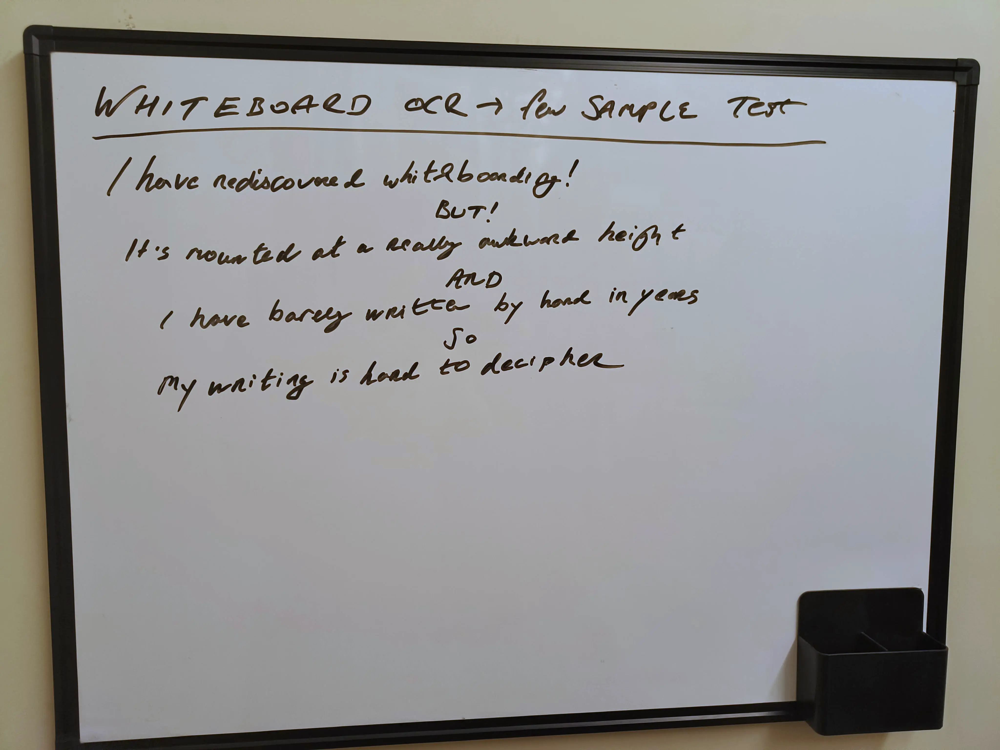
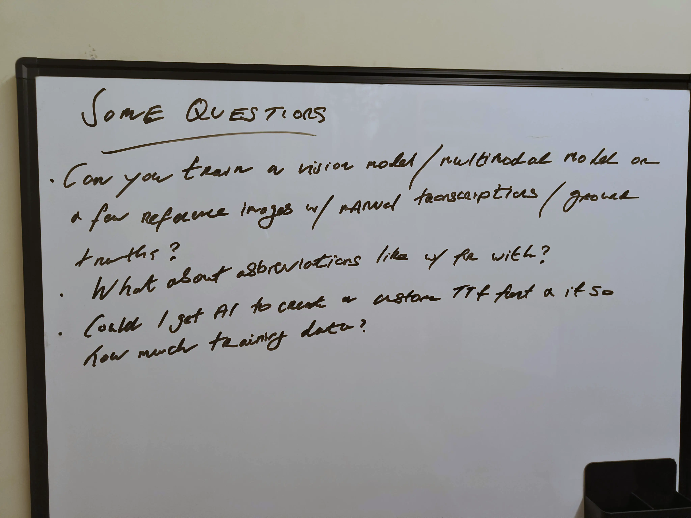
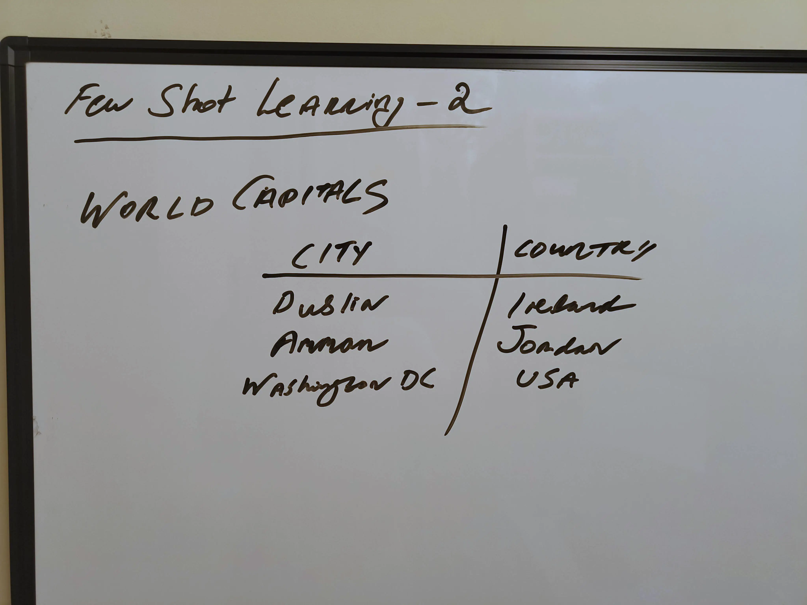
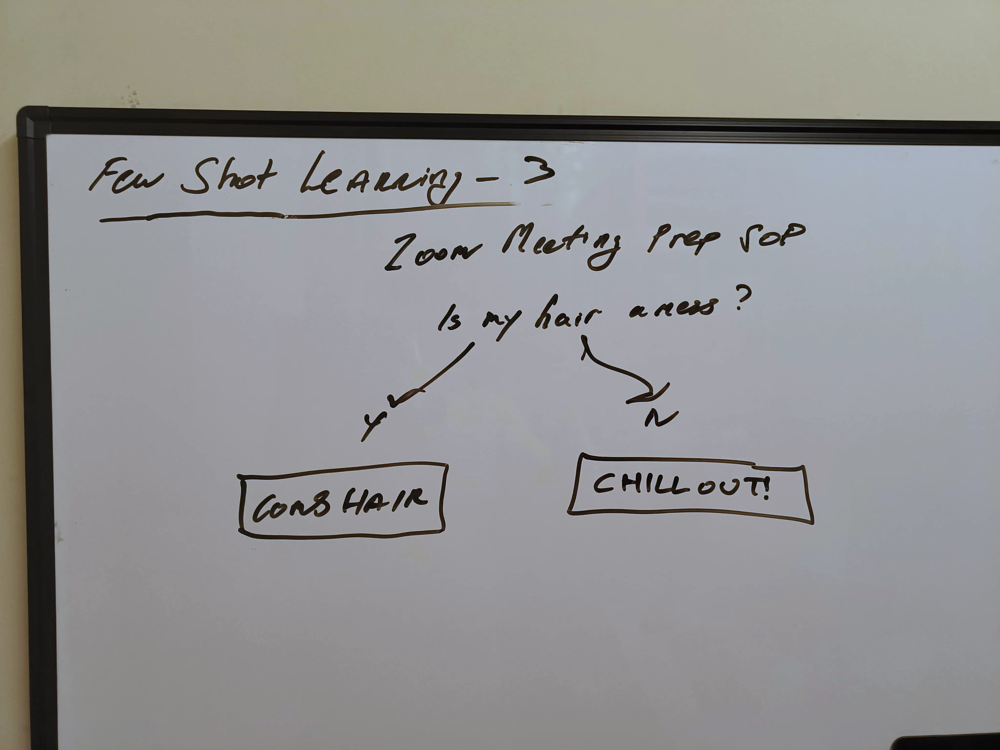
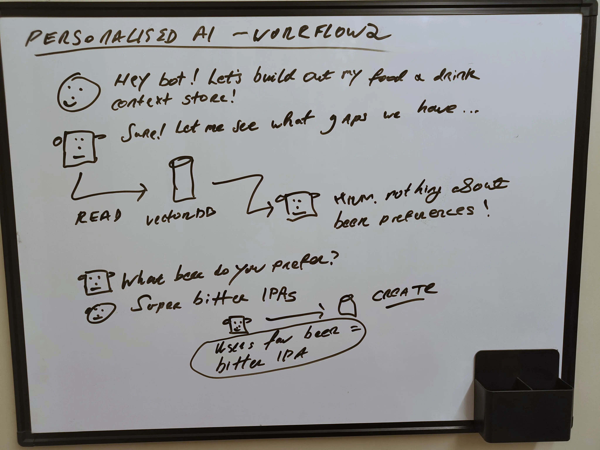
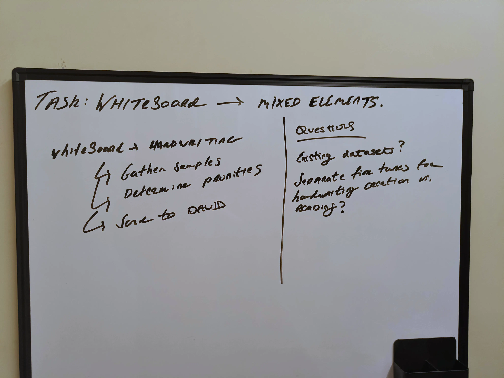

# Whiteboards


A small, single-author whiteboard corpus for evaluating vision-language
models on **handwritten OCR accuracy** and for studying **pseudotext
hallucination** — the failure mode where a VLM invents plausible-but-wrong
words for ambiguous handwriting.

Every image is the same wall-mounted whiteboard, same marker, same author,
photographed with a phone. This is deliberate: the dataset exists to
measure whether a small number of human-authored ground-truth pairs can
improve transcription on **a specific personal whiteboard**, not to train
a general-purpose OCR system.

- **21 samples**, ~150 KB WebP each, 4096×3072.
- **Fields**: `file_name`, `id`, `category`, `transcription`, `description`.
- **Split**: all rows are in `test`. Dataset is too small to train a split on.
- **Source repo**: <https://github.com/danielrosehill/Whiteboard-OCR-Few-Shot-Learning>

## Samples

One example per category:

| Prose (`01`) | List (`04`) | Table (`07`) |
|---|---|---|
|  |  |  |

| Flowchart (`08`) | Diagram (`13`) | Mixed (`19`) |
|---|---|---|
|  |  |  |

## Fields

| Field | Type | Description |
|---|---|---|
| `file_name` | string | Path to image (relative to `data/`). |
| `id` | string | Two-digit sample id (`01`…`21`). |
| `category` | string | Coarse content type — see below. |
| `transcription` | string | Human-authored verbatim ground truth (markdown, with arrows/symbols preserved). This is the primary OCR target. |
| `description` | string | Human-authored prose description of the board, for tasks that need semantic/structural grounding rather than verbatim text. |

### Categories

| Category | Count | What it means |
|---|---|---|
| `prose` | 2 | Handwritten sentences / paragraphs, no structure. |
| `list` | 6 | Bulleted, numbered, or indented hierarchical notes. |
| `table` | 2 | Row/column tabular content (calendar, capitals). |
| `flowchart` | 1 | Decision tree with yes/no branches. |
| `diagram` | 9 | Boxes-and-arrows / agent-workflow / architecture sketches. |
| `mixed` | 1 | Combinations (e.g., two-column with text + sketch). |

## Envisioned evaluation tasks

### 1. Zero-shot OCR accuracy (image → text)

Prompt a VLM with each image and a generic instruction ("transcribe this
whiteboard verbatim, preserving arrows and symbols"). Score the output
against `transcription`.

Suggested metrics:

- **CER** (character error rate) on the verbatim text.
- **Pseudotext count** — number of tokens in the prediction that do not
  appear in, and are not a plausible symbol-rendering of, the ground truth.
  This is the metric the dataset was built to measure.

### 2. Few-shot OCR (in-context grounding)

Hold out *N* samples. Show the model the other 21−*N* as `(image,
transcription)` pairs in the prompt, then ask it to transcribe the
held-out ones. Does CER and pseudotext count drop vs. zero-shot? This is
the dataset's core hypothesis.

### 3. Image-to-image preservation (whiteboard → clean diagram)

Feed each image to an image-edit model (e.g. Gemini 2.5 Flash Image /
Nano Banana, Flux Kontext, Qwen-Image-Edit) with a prompt like "redraw
as a clean tech diagram." OCR the output, diff against `transcription`.

Metric: **does the stylistic rewrite preserve text, or introduce
pseudotext?** Many image-edit models will silently "fix" words they
can't read, producing plausible but wrong diagrams — this dataset lets
you quantify that.

### 4. Structure/semantics tasks (using `description`)

- **Visual question answering**: ask the model questions whose answers
  require reading the board (e.g. "what does the bot ask the user?"
  for sample 13).
- **Captioning evaluation**: generate a description, compare to the
  human-authored `description` field with an LLM-as-judge.
- **Category classification**: predict `category` from the image alone.

### 5. Handwriting-specific probes

- **Abbreviation handling**: `w/`, `&`, `ppl`, etc. appear throughout.
- **Arrow / symbol rendering**: `→`, `↳`, `↔`, `↗` appear in ground truth.
- **Number/technical token OCR**: sample 18 has times (`0900`, `1500`),
  sample 20 has subscripted agent names (`A_1`, `SA_2`).

## Quickstart

```python
from datasets import load_dataset

ds = load_dataset("danielrosehill/Whiteboards", split="test")
print(ds[0]["transcription"])
ds[0]["image"]  # PIL.Image
```

Minimal zero-shot eval sketch:

```python
from datasets import load_dataset
from jiwer import cer

ds = load_dataset("danielrosehill/Whiteboards", split="test")
preds = [your_vlm(row["image"]) for row in ds]
refs = [row["transcription"] for row in ds]
print("CER:", cer(refs, preds))
```

## Known limitations

- **Single author, single board, single marker.** Not a general OCR
  benchmark — it's a probe for personal / few-shot grounding setups.
- **No multi-color samples.** All black marker.
- **Free-form markdown transcriptions**, not a structured
  `nodes/edges` schema. Diagram-structure evaluation needs a parser.
- **Some samples overlap** — e.g. 14/15/16 are progressive close-ups of
  the same diagram. This is deliberate (tests whether crop affects OCR)
  but should be accounted for in splits.
- **Personal content** — agent-workflow sketches, a calendar, food/drink
  preferences. No high-sensitivity PII, but review before redistributing
  downstream.

## Citation

```
@misc{whiteboards2026,
  author = {Rosehill, Daniel},
  title  = {Whiteboards: a small VLM OCR / pseudotext evaluation set},
  year   = {2026},
  url    = {https://huggingface.co/datasets/danielrosehill/Whiteboards}
}
```

## License

CC-BY-4.0.
